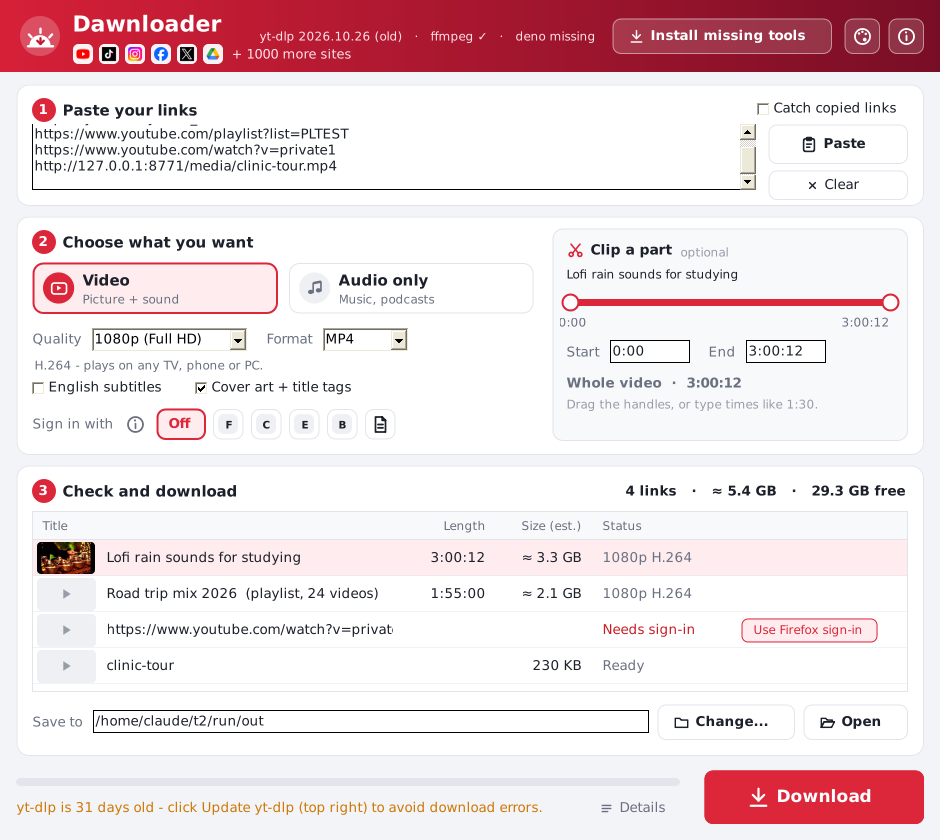
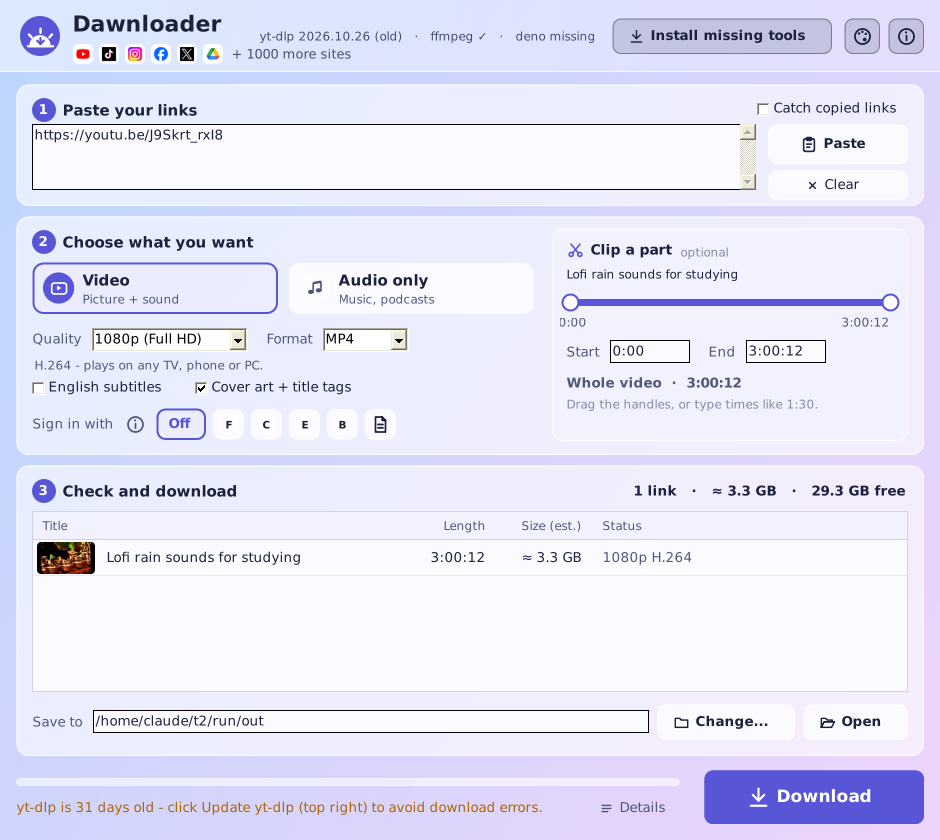

# Dawnloader

One-click Windows downloader for video and audio from YouTube, TikTok, Instagram, Facebook, X,
Google Drive and 1000+ other sites. A PowerShell launcher plus a WinForms window (C#) around
yt-dlp / ffmpeg / deno. Nothing is uploaded anywhere; everything runs on your PC.

## Features
- **Clip a part** - drag the handles or type start/end times to download only a section
- Paste links (or turn on "Catch copied links") and see title, length and estimated size before downloading
- Video (quality + MP4/MKV/WEBM) or audio only (MP3, M4A, OPUS, FLAC, WAV or original)
- Playlists, Google Drive files and folders (including private ones), direct links
- Skips what you already downloaded; "Show in folder" on finished rows
- One-click fixes in the list (Update yt-dlp, Use Firefox sign-in, Retry)
- Sign in with your browser's saved login only when a link needs it
- Five skins: Crimson, Midnight, Glass, Sunrise, Forest (Glass shown below)

## Use
Download [`releases/Dawnloader-2026.11.zip`](releases/Dawnloader-2026.11.zip), extract it, and double-click `Start Dawnloader.bat`
(or keep `dist/Dawnloader.ps1` and `Start Dawnloader.bat` together in one folder).
On first run the app offers to download yt-dlp, ffmpeg and deno (~180 MB, no admin) into
`%LOCALAPPDATA%\Dawnloader\tools`.

## Privacy
No account, no ads, no tracking. The app only connects to the sites of the links you add (plus their
icons for the header) and to GitHub / gyan.dev when installing or updating the helper tools.
Settings sit next to `Dawnloader.ps1`; download history and cached icons are in `%LOCALAPPDATA%\Dawnloader`.

## Develop
    python3 tools/build.py        # src/ytd.cs + src/launcher.template.ps1 -> dist/Dawnloader.ps1

See `CLAUDE.md` for architecture, constraints and the test setup.

## Disclaimer
For downloading content you own, that is licensed for reuse, or that you have permission to save.
Respect each site's terms and copyright law. Dawnloader does not bypass DRM and is not affiliated with
any of the sites it supports. Provided as is, without warranty (MIT licence).
